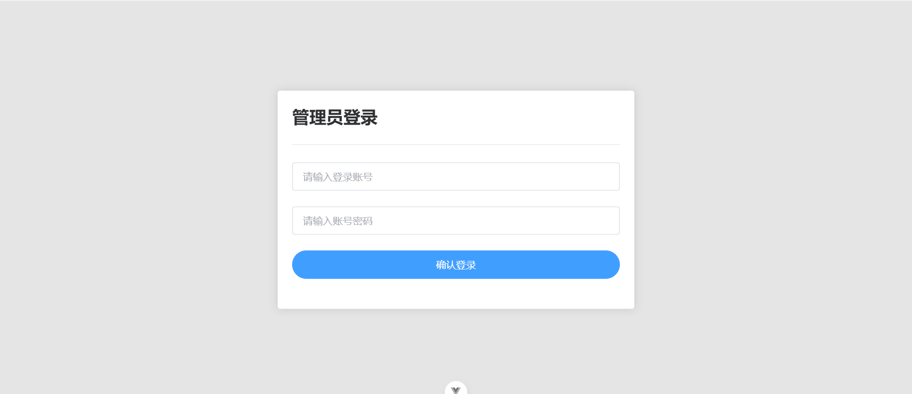
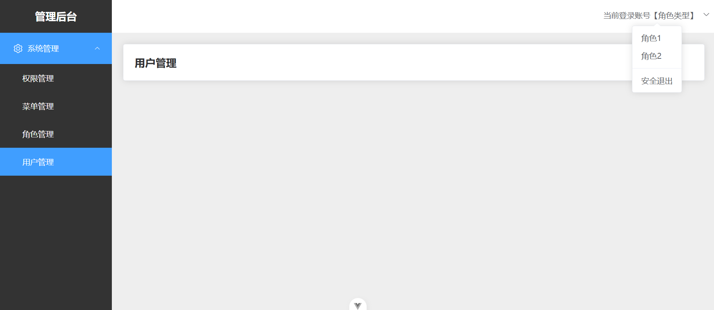
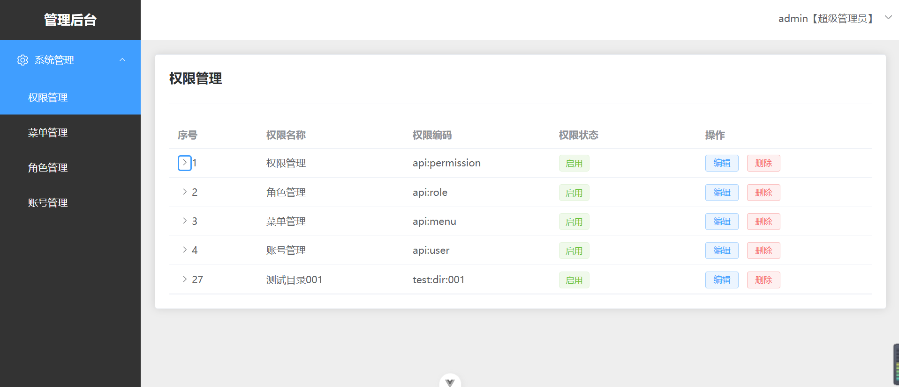
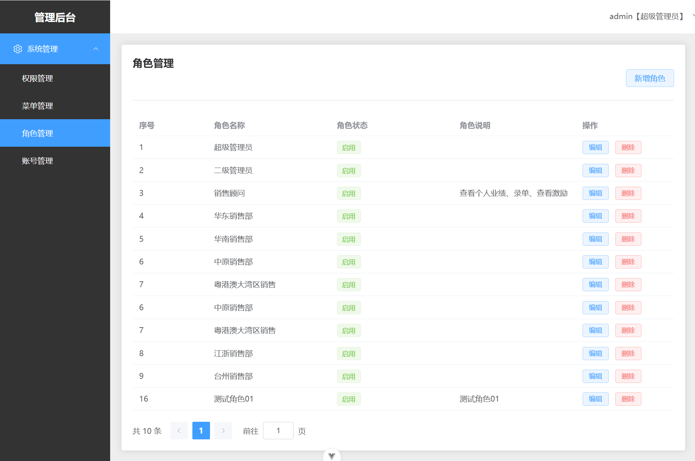

# vue-rbac后台管理系统

## 项目架构
vite+vue3

## 第三方依赖

```shell
npm i element-plus
npm i element-plus @element-plus/icons-vue
npm i axios
npm i pinia-plugin-persistedstate
```
## 核心功能参考效果图
### 登录页面

### 管理后台页面

### 权限管理页面

### 角色管理页面

## 后端接口地址
[后端数据接口地址](http://localhost:8000/api/schema/swagger-ui/)

## 参考文档
[axios中文网](https://www.axios-http.cn/)
[element-plus组件库官网](https://element-plus.org/zh-CN/)